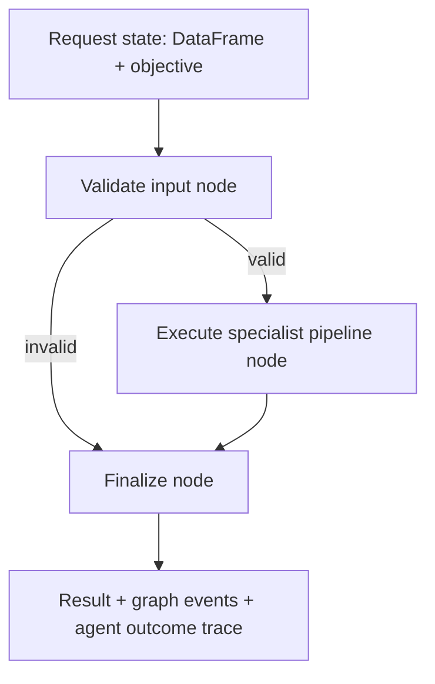

# Data Pilot V3 architecture

## Runtime layers

1. **React/Vite UI** — multi-section product shell and existing analysis workspace.
2. **FastAPI** — upload validation, async jobs, experiment history, reports, inference, research indexing/query and tool adapter.
3. **LangGraph lifecycle** — input validation → conditional specialist pipeline execution → finalization. It uses a StateGraph and in-memory checkpointer when installed. A labelled Python fallback is used only when LangGraph is absent.
4. **Specialist Python agents** — Planner, Security Guardian, EDA, Statistics, Preprocessing, ML, Critic, Replanner, Explainability, Research and Reporting.
5. **Data/model engines** — Pandas + optional DuckDB profiling; scikit-learn models + optional PyTorch MLP.
6. **Evidence and tracking** — SQLite experiment/research stores, local TF-IDF or optional semantic retrieval, optional Crossref, optional MLflow, optional MCP stdio server.

## Agent responsibility boundary

The Planner creates a declarative plan from profiler facts. The Security Guardian validates the plan before execution. Data agents calculate results deterministically. ML trains and evaluates models. The Critic evaluates measured metrics and may request one bounded replan. Explainability computes feature attributions. Research retrieves methodological guidance and indexed source passages. Reporting writes deterministic metrics and optionally asks an LLM to interpret verified facts. No agent executes user-provided Python code.

## LangGraph lifecycle

This graph currently wraps the existing specialist pipeline in one execution node. Specialist responsibilities are real Python components but are not yet separate LangGraph nodes. Per-experiment agent outcome traces are persisted with the analysis result; they are post-run summaries, not live streaming events.

## MCP boundary

`backend/mcp_server.py` is the actual MCP stdio server and requires the optional MCP SDK. `/api/tools` and `/api/tools/call` are separate REST tool adapter endpoints. Both use allowlisted schemas and avoid arbitrary filesystem paths or arbitrary code execution.

## Data engine

`get_engine(frame)` selects Pandas or DuckDB based on `DATAPILOT_DATA_ENGINE` and the configured memory threshold. DuckDB performs SQL-based profiling against a registered in-memory DataFrame. The current upload path still parses CSV/Excel/JSON with Pandas; no streaming ingestion is claimed.

## Research retrieval

User-provided text/PDF is chunked into a local SQLite index. TF-IDF cosine similarity is the default no-download retriever. Sentence Transformers embeddings can be enabled optionally. Results retain title, source, DOI, chunk label and excerpt. The Research Agent can add retrieved excerpts to the final report context. Crossref, when enabled, provides bibliographic metadata only.

## Operational boundaries

The current application is a single-node academic/demo deployment. SQLite, local artifact storage and in-memory graph checkpointing are not substitutes for multi-tenant databases, durable queues, object storage or distributed checkpointing.
